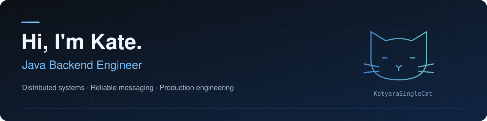

  

  <strong>5+ years in backend engineering · Telecom &amp; healthcare</strong>

I build, modernize, and support high-load enterprise systems. My work spans Java and Spring Boot, event-driven architectures, and the production challenges of keeping distributed systems reliable.

At ITSmartFlex (Vodafone UA), I work on a messaging platform with 100+ microservices, processing approximately 7 million customer messages daily across SMS, Viber, and RCS.
What I work on
- Reliable messaging — Kafka, Kafka Streams, Transactional Outbox, idempotency, retries, and recovery.
- Backend modernization — evolving legacy Java EE and monolithic applications into maintainable services.
- Production engineering — observability, performance tuning, incident investigation, and L2/L3 support.
- System design — cross-service consistency, failure scenarios, and architectural trade-offs.
Technology stack
Area	Technologies
Languages & backend	Java 8–25 · Spring Boot · Java EE · REST · SOAP
Messaging & streaming	Apache Kafka · Kafka Streams
Data	PostgreSQL · Oracle · Redis
Observability	OpenTelemetry · ELK · Metrics · Dashboards · SLO-based alerts
Platform & tooling	Kubernetes · Maven · JVM diagnostics · JFR
Additional experience	Angular · JSF · PrimeFaces

Selected engineering highlights
- Developed trigger-based messaging campaigns handling peak input rates of up to 50,000 events/sec from Big Data systems.
- Redesigned a Kafka Streams topology, improving processing performance by approximately 10–15% while reducing state-replication overhead.
- Implemented message-status functionality across 10–12 microservices to keep status propagation consistent throughout the messaging flow.
- Modernized healthcare systems used by 400+ laboratories across the USA, Canada, Europe, and Asia.
Experience

<strong>ITSmartFlex · Vodafone UA — Telecom messaging</strong>

- Consolidated two legacy Kafka Streams services and added metrics to detect message loss across the processing flow.
- Contributed to reliable processing workflows using Transactional Outbox, duplicate-event handling, rate limiting, and compensating operations.
- Upgraded backend services from Java 11 through Java 25, including production deployment and support.
- Implemented operational dashboards and SLO-based alerts for earlier incident detection.
- Investigated production issues across Kafka consumers, Elasticsearch logs, database state, Kubernetes resources, and application metrics.
- Provided L3 support alongside SRE engineers and helped onboard a new teammate through the buddy program.

<strong>ISD — Laboratory &amp; healthcare systems</strong>

- Migrated legacy Java EE, SOAP, and JSF components to Spring Boot, REST, and Angular.
- Upgraded applications from Java 8 to Java 21 and Spring Boot 2.7.8 to 3.4.2.
- Integrated OpenTelemetry tracing to identify slow operations and production bottlenecks.
- Reduced codebase complexity by approximately 30% and improved API response times by 200–300 ms through SOAP-to-REST migration.
- Modularized a Maven project and introduced a shared BOM, halving ZIP distribution assembly time.
- Rebuilt a JSF/PrimeFaces UI in Angular 19, improving page load speed by approximately 50% and reducing UI-related support tickets by approximately 40%.
- Handled on-call L2/L3 support, JVM and thread dump analysis, GC investigation, and high-severity incidents.
- Delivered knowledge-sharing sessions on JDK 25, Structured Concurrency, Scoped Values, AOT, JFR, and JVM/OSIV practices.

  Interested in Java, event-driven systems, and understanding how things behave in production.

